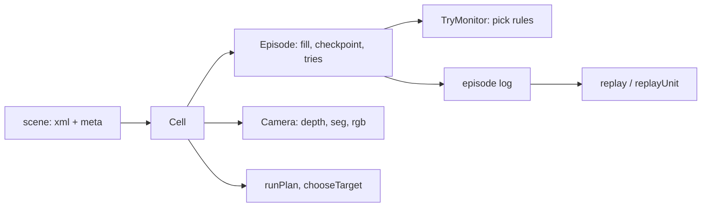
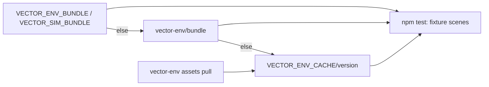

# vector-sim

The Vector bin cell engine: a UR10e arm with a Robotiq 2F-85 gripper over a bin of parts, simulated by MuJoCo
compiled to WebAssembly (`@mujoco/mujoco` 4.0.1). The browser, the environment and experts run the same JavaScript
on the same `.wasm`, so equal inputs give bit-equal states.

Scenes, assets and task limits come from vector-env; this package only runs them.



- One control tick is 1/20 s (10 physics steps of 5 ms). A row is 6 arm joint targets (rad) and the grip, 0 to 1.
- A try ends at `success`, `wrong_part`, `knocked_out`, `slipped`, `missed` or `timed_out` (`js/src/rules.js`);
  the time limit is the scene's `meta.config.rules.try_s`.

## Setup and tests

Node 22 or newer (`.nvmrc`: 24).

```bash
git clone https://github.com/robotensor/vector-sim && cd vector-sim
scripts/setup.sh
cd js && npm test
```

The tests and `bin/verify*.mjs` need the asset bundle and find it the way vector-env does (`js/src/bundle.js`,
`findBundle()`), in order:

1. `VECTOR_ENV_BUNDLE` (or `VECTOR_SIM_BUNDLE`), a bundle folder;
2. `<vector-env>/bundle`, where `<vector-env>` is `VECTOR_ENV_DIR` (default `../vector-env` beside this folder);
3. `VECTOR_ENV_CACHE/<version>` (default `~/.cache/vector-env/assets/<version>`), the folder
   `vector-env assets pull` fills; `<version>` is `VECTOR_ENV_ASSETS_VERSION` or `assets.version` in
   `<vector-env>/vector_env/env.yaml`.

`bundleFiles(dir, scene)` reads the meshes a scene names (`meta.files`, else the xml's `file=`) and refuses any
path that is absolute, has `.`/`..`/empty segments or a backslash, or resolves outside the bundle folder (links
the bundle folder itself holds are followed: they are the operator's, not the scene's).

So after `vector-env assets pull` in a vector-env beside this folder, `npm test` needs nothing else. With no bundle
the tests are skipped and say why. The tests run on the fixture scenes in `js/test/fixtures/`; their part meshes are
found in the bundle by content hash.



## License

Apache-2.0.
