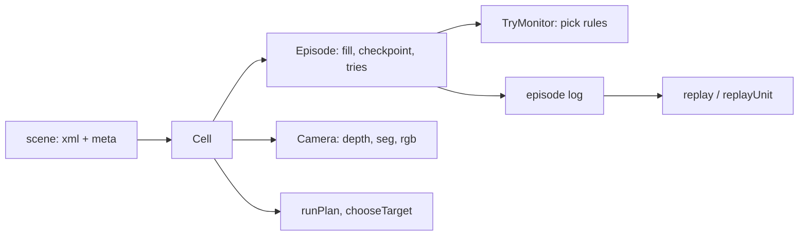
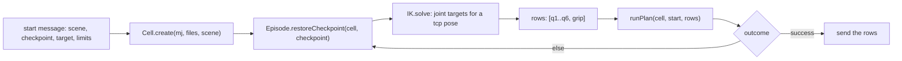
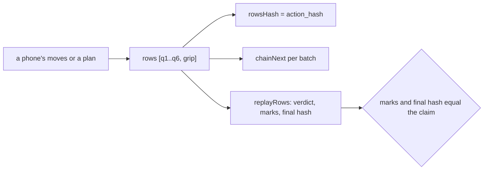
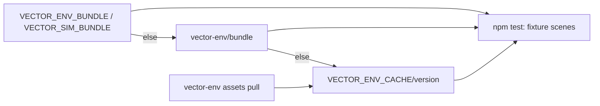

# bin-picking engine

The bin-picking cell engine of vector-sim: a UR10e arm with a Robotiq 2F-85 gripper over a bin of parts, simulated
by MuJoCo compiled to WebAssembly (`@mujoco/mujoco` 4.0.1). Browsers, the environment and experts run the same
JavaScript on the same `.wasm`, so equal inputs give bit-equal states. Every bin-picking leaf uses this engine.

Scenes, assets and task limits come from vector-env; this engine only runs them. Paths below are relative to this
folder (`js/skills/bin-picking/`); the spec is [spec.md](spec.md), the repository is described in
[../../../README.md](../../../README.md).

| path | content |
|---|---|
| `src/` | the engine; `src/index.js` is `@vector/sim` |
| `bin/verify.mjs`, `bin/verify_unit.mjs` | the bins `vector-verify` and `vector-verify-unit`: replay an episode log, or one unit, from stdin |
| `test/` | the tests, `test/helpers.js` (`@vector/sim/testing`) and the fixture scenes in `test/fixtures/` |
| `tools/dump_states.mjs` | a per-tick state dump of a scene |



- One control tick is 1/20 s (10 physics steps of 5 ms). A row is 6 arm joint targets (rad) and the grip, 0 to 1.
- A try ends at `success`, `wrong_part`, `knocked_out`, `slipped`, `missed` or `timed_out` (`src/rules.js`);
  the time limit is the scene's `meta.config.rules.try_s`.

## API

What an expert uses to plan a try in its own copy of the cell. Everything below is exported by `@vector/sim`
(`src/index.js`), except `mujoco` and `bundleFiles`, which are Node only and come from `@vector/sim/node.js`
(`src/node.js`). Units are SI (m, rad, s, kg); the world frame is z up, the floor of the bin at `crate.floor`.



### Loading a scene

| call | returns / does |
|---|---|
| `await mujoco()` (`node.js`) | the MuJoCo wasm module, loaded once and cached |
| `bundleFiles(dir, scene)` (`node.js`) | `{ files: Map<path, Uint8Array>, bundle }`: the meshes `scene` names, read from the bundle folder `dir` (in an expert: `process.env.VECTOR_SIM_BUNDLE`); throws on a path outside the bundle |
| `Cell.create(mj, files, scene)` | a `Cell` for `scene` (`{ xml, meta }`, the `start.scene` of the protocol) |
| `cell.dispose()` | frees the wasm memory; call it when you are done (a `Cell` is not garbage collected) |

### Cell

| member | meaning |
|---|---|
| `cell.m`, `cell.d` | the MuJoCo model and data; `cell.d.xpos[3*b .. 3*b+2]` is the world position of body `b`, `cell.d.qpos`, `cell.d.qvel` the state |
| `cell.meta` | the scene's `meta`: `parts[i]` (`body`, `qpos`, `dof`, `radius`, `type`), `robot`, `crate`, `camera`, `tick_s` (0.05), `substeps` (10) |
| `cell.cfg` | `meta.config`: `rules` (below), `control` (`hz` 20, `gripper_ctrl_max` 255, `closed_driver` 0.72) |
| `cell.R` | `meta.robot`: `q0` (home pose), `joint_range` (6 `[lo, hi]`, rad), `tcp_site`, actuator and qpos indexes |
| `cell.n`, `cell.active[i]` | number of parts; 1 while part `i` is in the scene (0 once taken away or parked) |
| `cell.crate` | `{ kind, x, y, cos, sin, ix, iy, floor, rim }`: bin centre, yaw, inner half sizes, floor and rim heights (m) |
| `cell.proprio()` | `{ q, grip }`: the 6 arm joint angles (rad) and the grip opening 0 (open) to 1 (closed) |
| `cell.tcp()` | `{ pos, mat }`: the tool point (the pinch point between the fingertips, site `g_tcp`) in world, `mat` row-major 3×3 |
| `cell.partZ(i)`, `cell.bottomZ(i)` | height of part `i`'s centre, and of its lowest convex-hull point (m) |
| `cell.inside(i)` | true while part `i`'s centre is inside the bin's walls, below `rim + rules.inside_above_rim` |
| `cell.contacts()` | `{ held, touch, padAny }`: per part, held = touched by both finger pads, touch = by any gripper body |
| `cell.gripClosed()` | the gripper driver is at or past `control.closed_driver` |
| `cell.activeParts()` | indexes of the parts in the scene |
| `cell.ctrl()`, `cell.step(row)` | the current row; one tick with `row` (10 physics steps of 5 ms) |
| `cell.snapshot()`, `cell.restore(s)` | save and restore the full physics state in memory (faster than a checkpoint) |
| `cell.hash()` | 16 hex characters: fnv64 of the physics state, the `state_hash` of the protocol |

A row is `[q1, …, q6, grip]`: 6 arm joint position targets (rad, clamped to `joint_range`) and the grip target 0 to
1 (`grip × 255` to the gripper actuator). The arm follows the targets through position servos, so a far target is
reached as fast as the torque allows; interpolate between poses yourself. An empty close takes about 6 ticks.

### Episode

| call | returns / does |
|---|---|
| `Episode.restoreCheckpoint(cell, checkpoint)` | puts `cell` back at `start.checkpoint` (the settled scene) and returns an `Episode` ready for a try; call it before each plan you test |
| `ep.beginTry(target)`, `ep.stepTry(row)` | start a try on part `target`, then one tick; `stepTry` returns `null` while the try runs, then the verdict |
| `ep.checkpoint()`, `ep.log(sceneId)` | the checkpoint after the last finished unit; the full episode log (see vector-env) |
| `CTRL` | 7, the length of a row |

### Planning

| call | returns / does |
|---|---|
| `new IK(cell)` | an inverse-kinematics solver on its own `MjData` (does not touch `cell.d`); `ik.dispose()` frees it |
| `ik.solve(q0, pos, mat, opts)` | damped least squares from the joint angles `q0` to the tcp at `pos` (world, m) with rotation `mat` (row-major 3×3). Returns `{ q, err, rot }`: joint angles, clamped to `joint_range`, and the position (m) and rotation errors left. It always returns the last iterate: check `err` (and `rot`) yourself, it does not throw when the pose is out of reach |
| `opts` | `iters` 30, `damping` 0.02, `maxStep` 0.3 (rad per iteration), `rotWeight` 0.3, `tol` 1e-4 (m; stops when `err < tol` and `rot < 10·tol`) |
| `ik.fk(q)` | `{ pos, mat }` of the tcp for joint angles `q` |
| `downMat(yaw = 0)` | the tcp rotation pointing the gripper straight down (tool z = world −z), turned by `yaw` (rad) about world z: tool x is `(cos yaw, sin yaw, 0)`, the axis the fingers close along |
| `runPlan(cell, start, rows, { limit })` | restores `start.checkpoint`, runs a try on `start.target` with `rows` (`number[][]`, flat array, `Float64Array` or base64), then holds the last row until the verdict. Returns `{ outcome, t, part, detail, tick, hash, n, held, ctrl }` (below). Throws on a malformed plan or more rows than `limit` (default `maxRows(cell)`) |
| `maxRows(cell)` | rows in a try: `ceil(rules.try_s / tick_s)` (300 for 15 s) |
| `planRows(rows)`, `planHash(rows)` | the rows as a checked flat `Float64Array`; its fnv64 |
| `chooseTarget(cell, seed, { minPx = 100 })` | the target vector-env would draw: a part in the bin with at least `minPx` camera pixels, picked by `seed`; `null` when none |

`runPlan` returns the verdict and where it fell:

| field | meaning |
|---|---|
| `outcome` | `success`, `wrong_part`, `knocked_out`, `slipped`, `missed` or `timed_out` |
| `t`, `tick` | try time (s) and tick of the verdict |
| `part`, `detail` | the part the verdict is about, and a short reason (`held 31 mm above the line`) |
| `hash` | `cell.hash()` at the verdict |
| `n` | rows of the plan run before the verdict |
| `held` | ticks the last row was held after the plan ran out |
| `ctrl` | the rows run, base64 of float64 |

Because the expert's cell and the harness run the same code on the same `.wasm`, a plan `runPlan` scores is what the
harness scores when the same rows are sent, as long as both run the same round tag (section [Rounds](#rounds)).

### Rules

`TryMonitor` (`src/rules.js`) gives the verdict each tick from `cell.cfg.rules`; `OUTCOMES` and `FAILURES` list
the outcomes. With the default rules:

| outcome | when |
|---|---|
| `success` | exactly one part is held by both pads with its lowest point at least `lift_clear` (0.05 m) above the rim, the only part of the bin up there, for `hold_s` (0.5 s), and it is the target |
| `wrong_part` | the same, for another part |
| `knocked_out` | a part of the bin is out of it and at rest for `out_settle_s` (0.2 s), or its centre below `-floor_below` (−0.03 m), without having been lifted |
| `slipped` | a part lifted by `lift_dz` (0.03 m) is lost from the pads for `lost_s` (0.2 s), or falls out of the bin |
| `missed` | the try ran out after closing on nothing and never holding a part, or the expert gave up |
| `timed_out` | `try_s` passed (the start message's `limits.time_limit_s`, 15 s) without another verdict |

### Action logs

A person's or an expert's try is a list of rows; `src/actions.js` is the one format both are logged, hashed and
replayed in (`vector-actions/1`). The console, the vector-env verifier and experts use the same code.

| export | use |
|---|---|
| `rowsHash(rows)`, `RowsHash` | FNV-1a 64 over every value as float64 little-endian (`-0` as `0`), 16 hex: the harness `action_hash`; `new RowsHash().rows(row)` adds rows as they come |
| `encodeRows(rows)`, `decodeRows(b64)`, `flatRows(rows)` | rows as base64 of float64, back, and a checked flat `Float64Array` (whole rows, finite) |
| `chainSeed(nonce, session, sceneId)`, `chainNext(prev, k, a, b, sh, flat)` | the console's running hash chain over log batches (`vector-console/1`) |
| `replayRows(cell, { checkpoint, target }, rows, { every, hold, limit })` | restore the checkpoint, run a try on `target` with the rows; `marks` = `[tick, cell.hash()]` every `every` ticks; `hold` keeps the last row until the verdict (expert semantics), else the result says how many rows came after the verdict (`extra`) or that there was none (`outcome: null`) |
| `probeRows(ctrl, ticks)`, `probe(cell, checkpoint, { ticks, every })` | a fixed 40-tick motion from the checkpoint and its hashes every 5 ticks, then the checkpoint again: the startup self-test that a runtime steps like the server |
| `yawCosSin(crate)` | the bin's yaw cosine and sine from its quaternion with exact arithmetic (no `Math.cos`), so every JavaScript engine computes the same rules |



`simPin()` (`node.js`) is `{sim, code, mujoco, wasm}`: the `version` of `js/package.json`, the sha256 of
`actions.js, cell.js, episode.js, hash.js, rules.js` (`name\0content\0` each), the MuJoCo version and the sha256 of
the `mujoco.wasm` it loads. Two runtimes with the same pin step the same rows to the same states; the console
refuses to play on another pin.

### Other exports

| export | use |
|---|---|
| `Camera(cell)`, `observe(cell, camera)` | the depth camera: `camera.render()` returns `{ width, height, depth, seg }`, depth a `Uint16Array` in units of `meta.camera.depth_unit` (0.1 mm), seg a `Uint8Array` (part `i` is `i + 1`, 254 the bin, 255 the robot, 0 the rest); `observe` adds `q` and `grip` |
| `obsBytes`, `obsHash`, `obsWire` | the observation as hashed and as sent on the wire |
| `runTry(ep, camera, act)` | a closed-loop try driven by an `act(obs, k)` callback (the browser and the harness use it) |
| `replay(cell, log)`, `replayUnit(cell, …)` | re-simulate an episode log, or one unit of it, and check every hash |
| `fillPlan`, `LOG_FORMAT` | the scene fill schedule; `vector-episode/2` |
| `fnv64`, `f64ToB64`, `b64ToF64`, `b64encode`, `b64decode` | the hash and encodings used in logs and messages |

The build is the single-thread `@mujoco/mujoco` (`mujoco.wasm`, not `mt/`): no threads, the same bytes in Node and
in browsers.

## Rounds

What miners run for a round is the git tag `<leaf-id>-r<n>` in vector-miner, vector-env and vector-sim (round 1 of
`bin-picking-expert` is `bin-picking-expert-r1`). An expert that plans with vector-sim builds against the tag of its
round (the vector-miner example's Dockerfile does, through `VECTOR_SIM_REF`), so the same rows give the same states.

## Setup and tests

Node 22 or newer (`.nvmrc`: 24).

```bash
git clone https://github.com/robotensor/vector-sim && cd vector-sim
scripts/setup.sh
cd js && npm test
```

`npm test` in `js/` runs these tests with the package's own. The tests and `bin/verify*.mjs` need the asset bundle
and find it the way vector-env does (`src/bundle.js`, `findBundle()`), in order:

1. `VECTOR_ENV_BUNDLE` (or `VECTOR_SIM_BUNDLE`), a bundle folder;
2. `<vector-env>/bundle`, where `<vector-env>` is `VECTOR_ENV_DIR` (default: the `vector-env` checkout beside the
   `vector-sim` checkout);
3. `VECTOR_ENV_CACHE/<version>` (default `~/.cache/vector-env/assets/<version>`), the folder
   `vector-env assets pull` fills; `<version>` is `VECTOR_ENV_ASSETS_VERSION`, else `assets.version` in
   `<vector-env>/vector_env/skills/bin_picking/env.yaml`, else in `<vector-env>/vector_env/env.yaml`.

`bundleFiles(dir, scene)` reads the meshes a scene names (`meta.files`, else the xml's `file=`) and refuses any
path that is absolute, has `.`/`..`/empty segments or a backslash, or resolves outside the bundle folder (links
the bundle folder itself holds are followed: they are the operator's, not the scene's).

So after `vector-env assets pull` in a vector-env checkout beside the vector-sim checkout, `npm test` needs nothing
else. With no bundle the tests are skipped and say why. The tests run on the fixture scenes in `test/fixtures/`;
their part meshes are found in the bundle by content hash.



## License

Apache-2.0 ([LICENSE](../../../LICENSE)).
